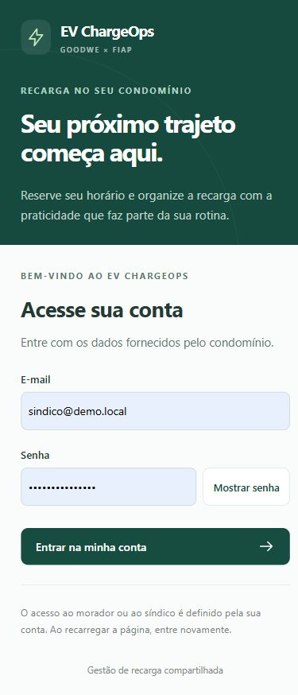
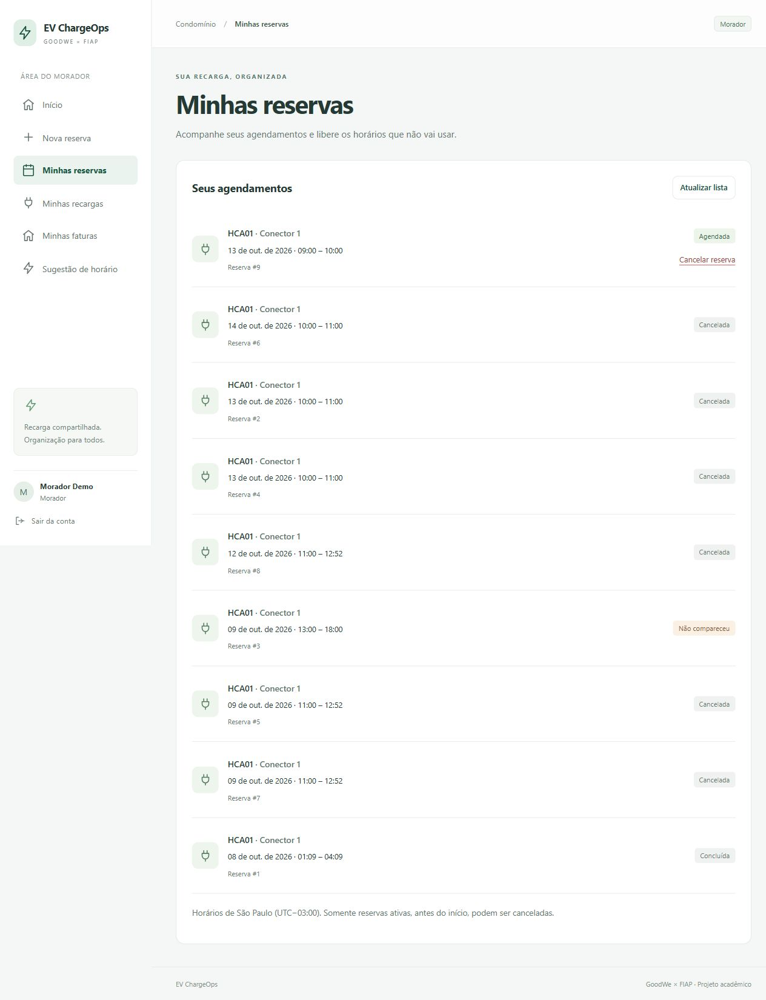
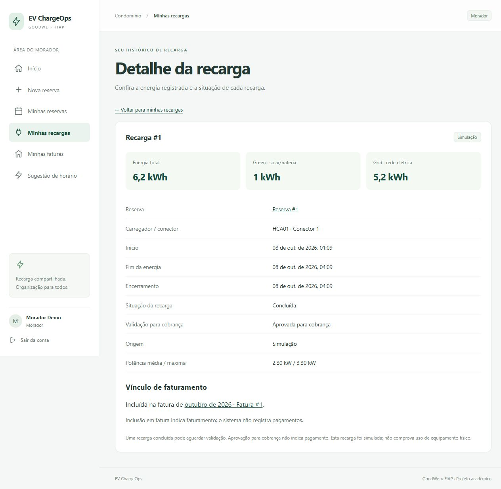
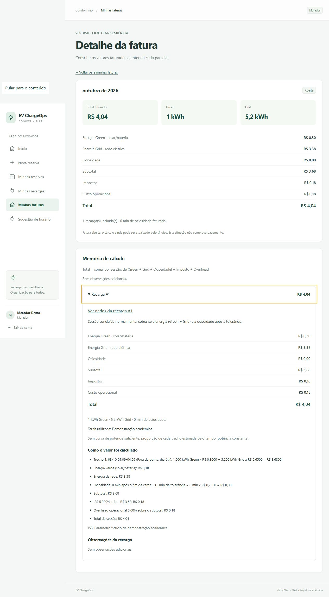
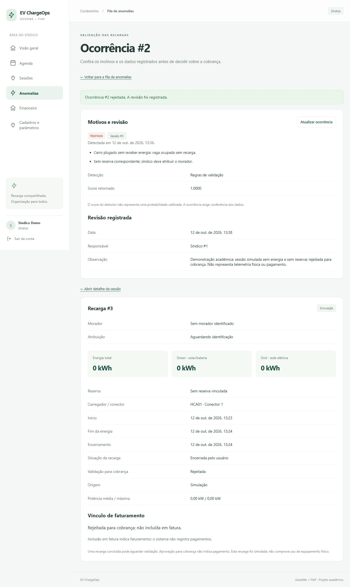
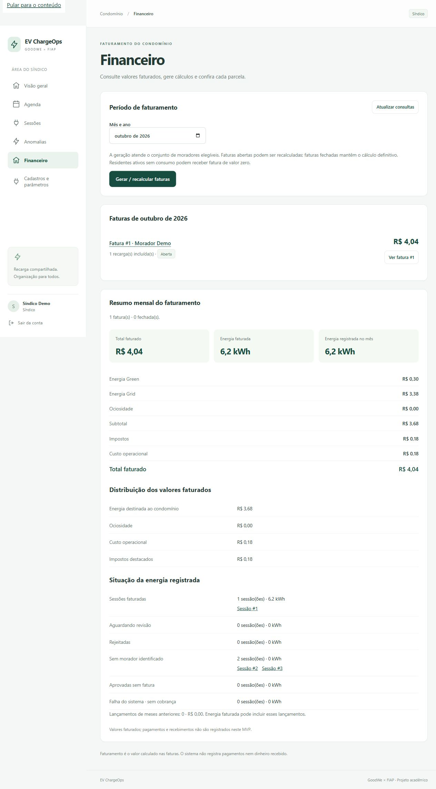

# EV ChargeOps — GoodWe × FIAP

**Enterprise Challenge 2026 · Sprint 02 — Desenvolvimento e prototipação**

Protótipo de gestão de recarga compartilhada em condomínios. O morador reserva um carregador, consulta recargas e entende sua fatura. O síndico acompanha reservas/sessões, revisa anomalias e consulta o faturamento e os parâmetros cadastrados.

O fluxo usa **FastAPI + PostgreSQL + React/TypeScript/Vite**. O detector combina regras físicas e Isolation Forest/LOF; o motor financeiro calcula Green/Grid, ociosidade, impostos e custo operacional com memória auditável. As sessões da demonstração são **simuladas**: não há conexão física GoodWe/SEMS/Modbus nem pagamentos.

## Equipe

| Integrante | RM |
|---|---|
| Eduardo Lopes da Silveira Mota | 563418 |
| Gabriel Luís de Lima Ramos | 568984 |
| Mayara Luisa Vicente Rosa | 571955 |
| Victor de Camargo Gomes | 568912 |
| Matheus Silveira | 570447 |

Identificação transcrita da [Sprint 01](docs/reference/sprint1/README.md). As entregas recebidas ficam preservadas em `deliveries/`.

## Comece por aqui

1. Execute a primeira instalação abaixo e prepare a demonstração pelo simulador.
2. Siga o [percurso de avaliação e pitch individual de 5 minutos](docs/ENTREGA-ACADEMICA.md).
3. Consulte a [validação funcional de 12/10/2026](frontend/RESOLUCAO-OVERVIEW.md) e a [verificação de instalação e pacote](docs/VALIDACAO-ENTREGA.md).

**Estado funcional documentado em 12/10/2026:** telas dos dois perfis implementadas, reservas, recomendação, sessões, faturas, financeiro e consulta administrativa. A rejeição de uma anomalia simulada foi persistida pela interface. Os logs daquela validação registram 50 testes frontend e 150 testes do conjunto backend selecionado, além do build. Aprovação humana/atribuição órfã pela interface, instalação PWA em aparelho e telemetria física não foram comprovadas. A primeira instalação é conferida separadamente em VALIDACAO-ENTREGA.

## Primeira instalação — Windows sem Docker

Pré-requisitos: **Python 3.12**, **Node.js 24/npm**, **PostgreSQL 16** e Git para clonar. Use PostgreSQL já instalado ou binários portáteis; a preparação está em [DEVELOPMENT.md](docs/DEVELOPMENT.md#primeira-instalação-nativa-no-windows).

```powershell
git clone https://github.com/GabrielLowis/GoodWe-EV-ChargeOps.git
cd GoodWe-EV-ChargeOps
python -m venv .venv
.\.venv\Scripts\python.exe -m pip install -r requirements.txt
npm.cmd --prefix frontend ci
.\.venv\Scripts\python.exe scripts/configure.py
```

Se baixou o ZIP, extraia-o e abra o terminal na pasta deste README; comece em `python -m venv .venv`. O configurador cria `.env` e `frontend/.env.local` somente se ausentes.

Prepare o PostgreSQL conforme DEVELOPMENT. Com os binários portáteis em `.local/pgsql`, execute:

```powershell
.\scripts\start-local.ps1
```

O helper inicia o banco, cria os bancos necessários, aplica migrations existentes, recompõe o modelo ativo e abre API/frontend em segundo plano, sem instalar serviço Windows. Para PostgreSQL administrado separadamente, use os comandos manuais de DEVELOPMENT; não use o helper portátil.

| Endereço padrão | Uso |
|---|---|
| http://127.0.0.1:5173 | Aplicativo |
| http://127.0.0.1:8000/docs | Swagger da API |
| http://127.0.0.1:8000/api/saude | Banco, migration e modelo |

| Conta de demonstração | Perfil |
|---|---|
| `morador@demo.local` | Morador — unidade A-101 |
| `sindico@demo.local` | Síndico |

Ambas usam **`DEMO_PASSWORD` do `.env` criado nesta instalação**. `SEED_DEMO=true` cria contas/parâmetros fictícios somente em banco sem usuários; não substitui senhas existentes. A senha demonstrativa do template é pública e serve para teste local. Não é necessário receber o arquivo de senhas dos autores. Sair/recarregar exige novo login: o token fica em memória.

## Preparar e avaliar a demonstração

Com a API ativa, em um **banco novo de demonstração**:

```powershell
.\.venv\Scripts\python.exe scripts/simulate.py
```

O simulador autentica as contas, cria uma reserva, ingere sessão `source=simulator`, passa pelo detector, revisa a anomalia demonstrativa se necessário e gera uma fatura pelo motor financeiro. Imprime os IDs de reserva, sessão e fatura. As datas são futuras para acelerar a demonstração; o período corresponde ao início da sessão no fuso do condomínio. A execução cria registros locais e pode recalcular uma fatura aberta: execute uma vez para preparar o percurso.

Entre como morador, consulte os registros retornados e expanda a memória da fatura. Entre como síndico e confira agenda, sessão, relatório do mesmo mês e parâmetros. Consulte a recomendação e abra o rascunho de reserva. Fila vazia é possível; a rejeição mostrada nas capturas não é um registro automaticamente distribuído pelo clone.

O [guia acadêmico](docs/ENTREGA-ACADEMICA.md#percurso-em-uma-instalação-nova) detalha a avaliação sem IDs/datas fixos. Não feche o período corrente: novos fechamentos só são permitidos depois que o mês terminar. Tarifas/impostos são parâmetros demonstrativos, não cobrança real.

Encerre o ambiente do helper com `.\scripts\stop-local.ps1`. No **banco existente dos autores**, use [EXECUCAO.md](frontend/EXECUCAO.md) e [APRESENTACAO.md](frontend/APRESENTACAO.md), preservando os registros históricos.

## Alternativa com Docker Compose

Docker/Compose foi preparado, mas **não foi executado neste computador**. A verificação de instalação usa a rota nativa. Com Python 3.12 e Docker Compose disponíveis:

```powershell
python scripts/configure.py
docker compose up --build
# Em outro terminal, preparar a demonstração:
docker compose --profile demo run --rm simulator
```

Compose aguarda o banco saudável, executa bootstrap e serve o aplicativo na porta 5173. Dados persistem em volume; `docker compose stop` encerra sem apagar esse volume. Comandos e testes: [DEVELOPMENT.md](docs/DEVELOPMENT.md).

## Estrutura e tecnologias

| Pasta | Responsabilidade |
|---|---|
| `frontend/` | React/TypeScript/Vite, telas, cliente OpenAPI, PWA e evidências |
| `backend/api/`, `backend/main.py` | FastAPI, autenticação, reservas, sessões e integração |
| `backend/db/`, `backend/migrations/` | SQLAlchemy/Alembic e schema PostgreSQL canônico |
| `backend/rateio/`, `backend/faturamento/` | Decimal, cálculos, snapshots, faturas e relatórios |
| `condocharge_ai/`, `data/` | Regras, scikit-learn/PyOD, treinamento e CSVs recebidos |
| `scripts/`, `infra/` | Configuração, operação local, simulador e inicialização do banco |
| `tests/`, `backend/tests/` | Testes Python, API, banco, rateio e IA |
| `docs/` | Instruções, decisões, contrato e referências acadêmicas |
| `deliveries/` | Frentes 2/3/4 originais; referência, não a aplicação executada |
| `.github/` | Workflow de testes, lint, build e conferência dos contratos |

`.env`, banco local, `.venv`, `node_modules`, builds e senhas locais não acompanham repositório/ZIP. O modelo ativo é reconstruído dos CSVs no bootstrap; o binário recebido da Frente 4 permanece como referência original.

## Decisões técnicas

- **Um schema canônico:** migrations/modelos da Frente 3 evitam bancos com tabelas e contratos divergentes.
- **Cálculo financeiro no backend:** Decimal e parcelas/snapshots persistidos; o frontend apresenta a API sem reproduzir fórmulas.
- **Detector na ingestão:** fachada `check_session` chamada pelo adaptador; suspeitas ficam suspensas para revisão antes da cobrança. Modelo indisponível impede ingestão.
- **Modelo reconstruído no runtime escolhido:** CSVs e dependências declaradas geram o artefato ativo sem carregar o pickle de outro ambiente.
- **Uma API para os perfis:** cliente OpenAPI e permissões do banco; o navegador não acessa PostgreSQL ou credenciais da IA.

Diagrama e conversões de contratos: [INTEGRATION.md](docs/INTEGRATION.md).

## Planejado na Sprint 01 / entregue / justificativa

| Planejado na Sprint 01 | Entregue na versão integrada | Justificativa documentada |
|---|---|---|
| SEMS+ e gateway Modbus com buffer local | Ingestão HTTP e simulador de sessões; sem conexão física | Frente 4 registrou falta de acesso físico e coleta histórica pela interface SEMS+. Endpoints/autenticação permanecem sem comprovação. O simulador HTTP não é um simulador Modbus. |
| Regressão/XGBoost e INMET para janela ótima | Baseline de 24 h, disponibilidade e tarifas, com solar hipotética | IA de recomendação ficou como evolução futura na Frente 4. Baseline demonstra o percurso no pacote acadêmico reduzido, sem alegar previsão treinada. |
| Detector servido ao backend | Isolation Forest/LOF e regras integrados por importação/fachada | Frente 4 escolheu menos infraestrutura para o protótipo; o adaptador liga a decisão à ingestão. |
| Tempo real e configuração completa no painel | Consultas/operações principais; parâmetros consultáveis | Plano da Frente 5 limitou quatro entregas em cerca de oito horas. Cadastros complexos/acabamento ficaram como extras; não há telemetria contínua. |
| Sessão sem reserva atribuída ao dono do cartão | Sessão órfã suspensa para atribuição humana | Contrato integrado usa cartão compartilhado e evita atribuir automaticamente cobrança ao custódio. |

Fontes: [Sprint 01](docs/reference/sprint1/README.md), [decisões da Frente 4](deliveries/frente4/DECISOES.md), [integração](docs/INTEGRATION.md) e [plano da Frente 5](docs/ENTREGAS-FRENTE5.md). CSVs históricos de treinamento não são telemetria conectada ao protótipo. Métricas do módulo original não representam automaticamente a avaliação do sistema integrado.

## Evidências selecionadas

Capturas existentes de **12/10/2026**, no banco demonstrativo dos autores. IDs, datas e valores documentam aquele ambiente, não resultados esperados em todo clone.

**1. Acesso:** tela de login.



**2. Reserva:** registros demonstrativos do morador.



**3. Sessão:** origem simulada e vínculo com a fatura.



**4. Memória da fatura:** parcelas e critérios da API.



**5. Anomalia:** rejeição humana persistida de sessão simulada sem energia.



**6. Financeiro:** valores faturados, não dinheiro recebido.



Relatório completo: [RESOLUCAO-OVERVIEW.md](frontend/RESOLUCAO-OVERVIEW.md). Histórico: [11/10](frontend/VALIDACAO-FINAL.md) e [preparação de 08/10](docs/VALIDATION.md).

## Testes e entrega acadêmica

```powershell
npm.cmd --prefix frontend test
npm.cmd --prefix frontend run build
# Somente com TEST_DATABASE_URL em banco exclusivo terminado em _test:
.\.venv\Scripts\python.exe -m pytest -q -p no:cacheprovider
```

O enunciado pede **TXT com o link do repositório**, contendo código, README e evidências. ZIP é complementar. A preparação gera localmente `entrega/ENTREGA.txt`, `entrega/EV-ChargeOps.zip` e `entrega/manifesto.json`; a pasta é ignorada para evitar incluir o ZIP no próprio pacote. O histórico começa com a base recebida e registra ajustes seguintes; não reconstitui commits das frentes nem comprova frequência anterior.

Uso de IA, matriz de requisitos, pitch e pendências humanas: [ENTREGA-ACADEMICA.md](docs/ENTREGA-ACADEMICA.md). Cada aluno deve explicar o código e gravar seu pitch de **5 minutos na prova presencial**. O envio na plataforma da faculdade é separado da publicação GitHub.

Sem comprovação: conexão física, pagamentos, aprovação/atribuição órfã pela interface e instalação PWA em aparelho. A PWA tem aviso de contingência; consultas e ações dependem da API conectada.
