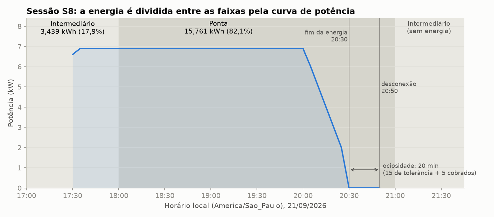
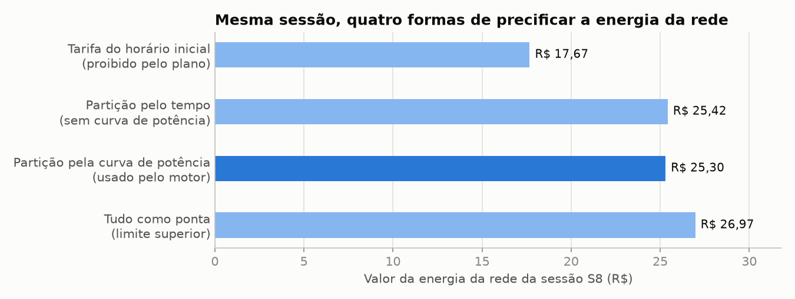

# EV ChargeOps - Frente 3: Banco de dados e motor de rateio

**Enterprise Challenge 2026 · Parceria GoodWe x FIAP · Sprint 02 - Desenvolvimento e prototipação**
Responsável pela frente: Mayara Luisa Vicente Rosa (RM 571955)

Esta frente "protege a consistência financeira do sistema e transforma sessões em cobranças auditáveis" (plano da
Sprint 2, seção 5). Ela implementa o banco de dados PostgreSQL do produto e o motor que aplica o **modelo de rateio
híbrido** definido na Sprint 01: energia por kWh separada em Green (solar) e Grid (rede), precificada por faixa
horária, mais tarifa de ociosidade, imposto e overhead parametrizáveis, com memória de cálculo auditável.

## Sumário

1. [O que foi implementado](#1-o-que-foi-implementado)
2. [Como executar](#2-como-executar)
3. [Estrutura dos arquivos](#3-estrutura-dos-arquivos)
4. [Como o rateio funciona](#4-como-o-rateio-funciona)
5. [Regras de integridade garantidas pelo banco](#5-regras-de-integridade-garantidas-pelo-banco)
6. [Decisões técnicas](#6-decisões-técnicas)
7. [Desvios em relação à Sprint 01](#7-desvios-em-relação-à-sprint-01)
8. [Dependências das outras frentes](#8-dependências-das-outras-frentes)
9. [Evidências de funcionamento](#9-evidências-de-funcionamento)
10. [Limitações e próximos passos](#10-limitações-e-próximos-passos)
11. [Uso de IA nesta frente](#11-uso-de-ia-nesta-frente)

---

## 1. O que foi implementado

| Entrega do plano (Pessoa 3 - Banco + Rateio) | Onde está |
|---|---|
| Schema com as 10 entidades do plano + 6 tabelas de apoio | `backend/migrations/versions/0001_schema_inicial.py`, `backend/db/models.py` |
| Migrations que funcionam do zero (Alembic) | `alembic upgrade head` / `alembic downgrade base` |
| As 5 regras de integridade do plano garantidas pelo PostgreSQL | restrições `EXCLUDE`, FKs compostas, `CHECK` e gatilhos na migration |
| Tarifas versionadas por vigência (faixas, Green/Grid, ociosidade, overhead) | tabelas `tariffs`, `tariff_bands`, `tariff_windows` |
| Imposto parametrizável por jurisdição e período (ICMS, ISS, IBS, CBS) | tabela `tax_rules` |
| Motor de rateio: fórmula da Sprint 1, sessão que atravessa faixas, casos excepcionais | `backend/rateio/` |
| Fatura mensal com memória de cálculo em JSONB, fechamento imutável | `backend/faturamento/service.py` |
| Revisão de anomalia com auditoria (integração com a Frente 4) | gatilho `fn_anomaly_audit` + `review_anomaly()` |
| Relatório de arrecadação para o síndico (reembolso ao condomínio) | `backend/faturamento/report.py` |
| Testes financeiros e de integridade | `backend/tests/` - **119 testes passando** |
| Evidências | `evidencias/frente3/`, `notebooks/frente3_motor_de_rateio.ipynb` |

## 2. Como executar

Pré-requisitos: Python 3.12 e PostgreSQL 16 (pelo Docker ou instalado). Todos os comandos rodam a partir da raiz do
repositório.

```bash
# 1. Banco de dados (cria os bancos evchargeops e evchargeops_test)
docker compose -f docker-compose.frente3.yml up -d

# 2. Ambiente Python
python -m venv .venv
source .venv/bin/activate            # Windows (PowerShell): .venv\Scripts\Activate.ps1
pip install -r requirements-frente3.txt

# 3. Variáveis: os valores padrão já apontam para o banco do docker-compose.
#    Para outro banco, exporte DATABASE_URL e TEST_DATABASE_URL (modelo em .env.example).

# 4. Criar o schema
alembic upgrade head

# 5. Testes (motor sem banco + integração com PostgreSQL)
python -m pytest backend/tests -v

# 6. Demonstração ponta a ponta (recria o schema e usa dados fictícios de setembro/2026)
python scripts/demo_frente3.py --reset
```

- Sem PostgreSQL disponível, os testes de integração são pulados com aviso e os 68 testes do motor continuam rodando.
- Sem Docker: crie os bancos `evchargeops` e `evchargeops_test` no seu PostgreSQL e ajuste `DATABASE_URL` e
  `TEST_DATABASE_URL` (ver `.env.example`). No Windows, use `$env:DATABASE_URL="..."` no PowerShell.
- Notebook de evidência: abra `notebooks/frente3_motor_de_rateio.ipynb` (não precisa de banco).

## 3. Estrutura dos arquivos

```
backend/
  config.py                    variáveis de ambiente (banco, fuso, jurisdição)
  db/
    enums.py                   valores de status (espelham os CHECK do banco)
    models.py                  modelos ORM (SQLAlchemy 2.0)
    base.py                    engine e sessões
  migrations/versions/
    0001_schema_inicial.py     schema, restrições e gatilhos (fonte da verdade)
  rateio/                      motor de rateio puro (sem banco)
    engine.py                  calculate_session e summarize_invoice
    bands.py                   faixas horárias e divisão da sessão em trechos
    allocation.py              kWh por trecho (curva de potência / tempo, maiores restos)
    idle.py                    ociosidade e fim do fluxo de energia
    models.py, money.py        estruturas de dados e aritmética com Decimal
  faturamento/
    service.py                 gerar, recalcular e fechar faturas; revisar anomalias
    report.py                  relatório de arrecadação
    repository.py, mappers.py  consultas e conversão ORM -> motor
  seeds/                       cenário de demonstração e feriados da ANEEL
  tests/                       rateio/ (motor) e db/ (PostgreSQL)
scripts/demo_frente3.py        demonstração ponta a ponta
notebooks/                     notebook executado com gráficos
docs/frente3/                  documentação detalhada
evidencias/frente3/            saídas da demo e dos testes, JSONs e gráficos
```

Documentação detalhada:
[modelo de dados](docs/frente3/modelo-de-dados.md) ·
[motor de rateio](docs/frente3/motor-de-rateio.md) ·
[contratos com as outras frentes](docs/frente3/contratos-integracao.md) ·
[issues](docs/frente3/issues.md) ·
[guia de estudo](docs/frente3/guia-de-estudo.md)

## 4. Como o rateio funciona

| Parcela (por sessão) | Cálculo |
|---|---|
| Energia Green | kWh solar de cada trecho x preço Green da faixa do trecho |
| Energia Grid | kWh da rede de cada trecho x preço Grid da faixa do trecho |
| Ociosidade | minutos completos após o fim da energia, menos 15 de tolerância, x taxa por minuto |
| **Subtotal** | Green + Grid + Ociosidade |
| Imposto | subtotal x alíquota vigente (um ou mais tributos; a energia compensada pode sair da base) |
| Overhead | subtotal x percentual da assembleia (pode ser 0%) |
| **Total** | Subtotal + Imposto + Overhead; a fatura mensal soma as sessões válidas do morador |

**Sessão que atravessa faixas (caso obrigatório do plano).** A sessão é dividida em trechos de faixa constante e a
energia medida é distribuída entre eles pela curva de potência (ou pelo tempo, se não houver curva). Nunca se usa a
tarifa do horário inicial para a sessão inteira.



**Casos excepcionais da Sprint 01:** falha do sistema gera linha de R$ 0,00 com o motivo; sessão encerrada pelo
morador paga só a energia; morador sem uso recebe fatura zero; dois veículos da mesma unidade geram duas faturas;
no-show não gera cobrança. Detalhes e conferência manual de todos os valores em
[docs/frente3/motor-de-rateio.md](docs/frente3/motor-de-rateio.md).

## 5. Regras de integridade garantidas pelo banco

| Regra do plano | Mecanismo no PostgreSQL |
|---|---|
| Uma sessão não pode ser cobrada para dois moradores | `UNIQUE(session_id)` nos itens + FKs compostas que amarram item, fatura e sessão ao mesmo morador |
| Reservas não se sobrepõem além da capacidade | `EXCLUDE USING gist` por carregador, conector e intervalo + gatilho de capacidade |
| Tarifas versionadas, fatura antiga reproduzível | vigências sem sobreposição; tarifa/alíquota já faturada não pode mudar; cópia da tarifa na memória |
| Fatura fechada não muda silenciosamente | gatilhos bloqueiam UPDATE/DELETE; só fecha se os totais batem com os itens |
| Revisão de anomalia deixa auditoria | gatilho grava `audit_events` (somente inserção) e atualiza a sessão |

Também: SEMS e gateway não conseguem gravar duas vezes a mesma recarga (sessões sobrepostas no mesmo conector são
recusadas) e sessão suspeita não entra em fatura. Cada regra tem teste em `backend/tests/db/test_integrity.py`.

## 6. Decisões técnicas

| Decisão | Justificativa |
|---|---|
| Regras de integridade no banco, não só no Python | Valem para qualquer caminho de escrita (API, script, `psql`) e sob concorrência. É o que torna a cobrança confiável. |
| Motor de rateio puro, separado do banco | Toda a regra financeira é testável sem PostgreSQL (68 testes em 0,1 s) e pode ser reaproveitada pela recomendação de horário (Frente 4) para mostrar custo previsto com a mesma regra da fatura. |
| `Decimal` e `NUMERIC`, nunca `float` | Evita erros binários de arredondamento em dinheiro. |
| Arredondamento ao centavo por parcela e por sessão (meio para cima) | A soma das linhas fecha exatamente com o total da fatura, e o morador consegue conferir com uma calculadora. |
| Curva de potência para dividir a energia entre faixas | A potência cai no fim da carga; dividir só pelo tempo superestima o último trecho. A curva define a proporção; o total cobrado é o do medidor. |
| Método dos maiores restos para os kWh por trecho | A soma dos trechos fecha exatamente com o kWh medido, sem Wh criado ou perdido. |
| Cópia da tarifa na memória de cálculo (JSONB) | A fatura é reproduzível mesmo que a configuração atual mude (regra do plano e LGPD art. 20). |
| Vigência também para impostos, com vários tributos ao mesmo tempo | Atende à transição ICMS/ISS -> IBS/CBS mapeada na Frente 2 da Sprint 1. |
| Fatura por morador, gerada até com valor zero | Implementa "dois veículos, duas faturas" e "sem uso, fatura zero" de forma explícita e auditável. |
| Sessão liberada depois do fechamento entra na fatura seguinte | Fatura fechada é imutável; a sessão é cobrada uma vez, com a tarifa da data em que aconteceu. |
| Fuso horário explícito (`America/Sao_Paulo`) e `TIMESTAMPTZ` | As faixas são horário local; os instantes ficam sem ambiguidade no banco. |

## 7. Desvios em relação à Sprint 01

| Planejado na Sprint 01 | Implementado | Por quê |
|---|---|---|
| Imposto "sobre o subtotal das sessões" do mês | Imposto calculado em cada sessão, com a regra vigente naquela data, e somado na fatura | Respeita a vigência quando a alíquota muda no meio do mês. Como o imposto é proporcional, o valor é o mesmo, a menos de centavos de arredondamento. |
| Sessão sem reserva atribuída ao dono cadastrado do cartão | O banco aceita as duas opções; por padrão a sessão fica "sem atribuição" e não é faturada até o síndico decidir | O plano da Sprint 2 (decisão em aberto nº 4) recomenda não cobrar automaticamente o dono de um cartão compartilhado. Decisão final do grupo. |
| Ociosidade contada "a partir do fim do fluxo de energia" | Novo campo `energy_ended_at`; se não vier, estimado pela curva de potência; sem os dois, não se cobra ociosidade | O SessionDTO do plano não traz o fim da energia. Na falta do dado, a decisão é a favor do morador. |
| Imposto como percentual destacado | Cálculo "por fora" (percentual sobre a base) | Simplificação do MVP, como pede o plano ("sem transformar o sistema em motor tributário"). O ICMS real é "por dentro". |
| Green e Grid por faixa horária | Proporção Green/Grid da sessão aplicada a todos os trechos, salvo se a curva trouxer a parcela solar por instante | A SEMS mostra Green/Grid por sessão; a separação por intervalo depende de confirmação da Frente 1. |
| Capacidade simultânea do condomínio para o agendamento | Capacidade garantida por carregador (número de conectores) | É a regra de integridade do plano da Sprint 2; um limite do condomínio inteiro fica como regra do backend. |

## 8. Dependências das outras frentes

Resumo do que pedir aos colegas (detalhes em [contratos-integracao.md](docs/frente3/contratos-integracao.md)):

- **Frente 1 (GoodWe/IoT):** incluir no SessionDTO `energy_ended_at`, `connector`, `failure_code`, `source` e a
  curva de potência; horários sempre com fuso; `status` padronizado (`completed`, `user_stopped`, `system_failure`);
  confirmar se a SEMS separa Green/Grid por intervalo e a potência do HCA G2 do laboratório.
- **Frente 2 (Backend):** gravar sessões pelo mapeamento documentado; tratar sessão duplicada como reconciliação;
  expor os endpoints de fatura, anomalia e relatório; decidir o destino da sessão sem reserva.
- **Frente 4 (IA):** aprovar sessões normais e inserir as suspeitas em `anomalies`.
- **Frente 5 (Frontend):** telas de fatura e detalhe a partir do JSON da memória de cálculo; fila de anomalias,
  versões de tarifa e relatório no painel do síndico.

## 9. Evidências de funcionamento

| Evidência | Arquivo |
|---|---|
| Saída dos 119 testes (motor + PostgreSQL) | [evidencias/frente3/pytest_output.txt](evidencias/frente3/pytest_output.txt) |
| Demonstração ponta a ponta com PostgreSQL | [evidencias/frente3/demo_output.txt](evidencias/frente3/demo_output.txt) |
| Notebook executado, com tabelas e gráficos | [notebooks/frente3_motor_de_rateio.ipynb](notebooks/frente3_motor_de_rateio.ipynb) |
| Fatura completa com memória de cálculo (JSON) | [evidencias/frente3/fatura_ana_2026-09.json](evidencias/frente3/fatura_ana_2026-09.json) |
| Relatório de arrecadação (JSON) | [evidencias/frente3/relatorio_arrecadacao_2026-09.json](evidencias/frente3/relatorio_arrecadacao_2026-09.json) |
| Diagrama entidade-relacionamento | [evidencias/frente3/der_modelo_de_dados.png](evidencias/frente3/der_modelo_de_dados.png) |

Resultado da demonstração (setembro/2026, dados fictícios):

| Morador | Unidade | Sessões | Total | Destaque |
|---|---|---|---|---|
| Ana Souza | A-101 | 3 | R$ 43,54 | sessão que atravessa faixas; feriado fora de ponta; 14 min sem ociosidade |
| Bruno Lima | A-101 | 2 | R$ 24,26 | mesma unidade da Ana, fatura separada; sessão encerrada pelo morador |
| Carla Mendes | A-102 | 0 | R$ 0,00 | não carregou: fatura zero |
| Diego Rocha | B-201 | 3 | R$ 22,74 | lançamento posterior de agosto; 16 min = 1 min cobrado; falha do sistema R$ 0; 50 kWh em 90 min rejeitado |

A tentativa de zerar uma fatura fechada é recusada pelo banco, e o relatório fecha o balanço de energia:
144,8 kWh entregues = 84,0 faturados + 4,3 de falha + 50,0 rejeitados + 6,5 sem atribuição.



## 10. Limitações e próximos passos

- Estorno ou crédito de fatura já fechada ainda não existe: correções entram como ajuste na fatura seguinte.
- Imposto calculado "por fora"; ICMS "por dentro", substituição tributária e emissão de nota fiscal estão fora do MVP.
- Um único condomínio (sem multi-tenancy), como definido no escopo da Sprint 2.
- Dados de demonstração fictícios: preços, alíquotas e nomes precisam ser substituídos pelos definidos pela
  assembleia e pelo enquadramento real.
- Reconciliação SEMS x gateway e regra de no-show dependem da implementação da Frente 2 (o banco já dá o suporte).
- Sugestão ao grupo: cobrar ociosidade também de sessão encerrada pelo app, para fechar a brecha de encerrar a carga
  e deixar o carro na vaga (hoje segue a regra da Sprint 01, que isenta).

## 11. Uso de IA nesta frente

Seguindo a orientação do desafio (uso de IA permitido, com código compreendido e autoral), registramos:

- **Ferramenta:** Claude (Anthropic).
- **Como foi usada:** gerar uma primeira versão do código, dos testes e desta documentação a partir dos documentos da
  Sprint 01 (Frentes 1, 2 e 3, README e registro de uso de IA) e do plano da Sprint 2.
- **O que veio da equipe:** as regras de negócio implementadas (modelo híbrido, tolerância de 15 minutos, casos
  excepcionais, imposto parametrizável, detecção de anomalia antes da fatura, identidade na reserva e não no cartão)
  são decisões da Sprint 01. As decisões novas estão nas seções 6 e 7.
- **Revisão da integrante:** _[preencher antes da entrega: o que foi lido e testado, o que foi alterado e por quê,
  quais decisões foram confirmadas ou mudadas com o grupo]._

## Referências

- Plano de desenvolvimento da Sprint 2 (documento do grupo), seções 5, 8, 12, 13 e 14.
- README e documentos da Sprint 01: Frente 1 (Tarifa Branca e pesquisa de campo), Frente 2 (camadas normativas,
  SEMS+, tributação) e Frente 3 (arquitetura, fluxo de dados e modelo de rateio).
- ANEEL. Postos tarifários (lista de feriados nacionais fora de ponta).
  https://www.gov.br/aneel/pt-br/assuntos/tarifas/entenda-a-tarifa/postos-tarifarios
- PostgreSQL 16 Documentation: Exclusion Constraints e extensão btree_gist.
  https://www.postgresql.org/docs/16/ddl-constraints.html
