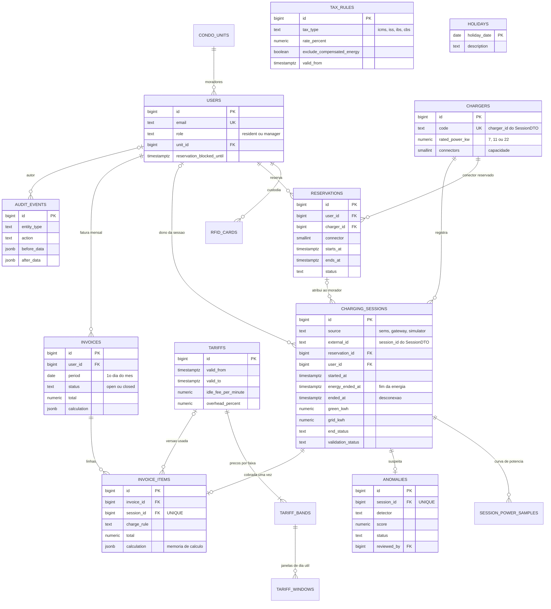

# Frente 3 - Modelo de dados (PostgreSQL 16)

O schema é criado pela migration `backend/migrations/versions/0001_schema_inicial.py`, que é a fonte da verdade.
Os modelos ORM em `backend/db/models.py` espelham as tabelas, e o teste
`test_modelos_orm_e_migration_nao_divergem` confere que os dois continuam iguais.

## 1. Diagrama entidade-relacionamento

`TAX_RULES` e `HOLIDAYS` não têm chave estrangeira: são consultadas por vigência (imposto) e por data (feriado).
Os itens de fatura guardam os ids dos impostos usados em `tax_rule_ids`.

## 2. Tabelas

As 10 entidades do plano da Sprint 2, mais 6 tabelas de apoio.

| Tabela | Entidade do plano | Papel |
|---|---|---|
| `users` | User | Morador (`resident`) ou gestor/síndico (`manager`). Todo morador tem unidade. |
| `condo_units` | CondoUnit | Apartamento (bloco + número). Vários moradores por unidade. |
| `chargers` | Charger | HCA G2: código usado no SessionDTO, potência nominal e número de conectores. |
| `reservations` | Reservation | Janela reservada em um conector. Status: `active`, `in_use`, `completed`, `cancelled`, `no_show`. |
| `charging_sessions` | ChargingSession | Sessão normalizada (SEMS, gateway ou simulador), com atribuição, validação e encerramento. |
| `tariffs` | Tariff | Versão da tabela tarifária aprovada pela assembleia, com vigência, ociosidade e overhead. |
| `invoices` | Invoice | Fatura mensal de um morador, com os totais e a memória de cálculo da fatura. |
| `invoice_items` | InvoiceItem | Uma linha por sessão, com as cinco parcelas e a memória de cálculo da sessão (JSONB). |
| `anomalies` | Anomaly | Sessão suspeita (saída da Frente 4) e a decisão do síndico. |
| `audit_events` | AuditEvent | Trilha de auditoria, somente inserção. |
| `rfid_cards` | apoio | Pool de cartões RFID compartilhados (até 10 por HCA G2), sob custódia do síndico. |
| `session_power_samples` | apoio | Curva de potência da sessão (kW por instante), usada no rateio e pela IA. |
| `tariff_bands` | apoio | Preço Green e Grid de cada faixa (`off_peak`, `intermediate`, `peak`) em uma versão de tarifa. |
| `tariff_windows` | apoio | Janelas de dia útil da ponta e do intermediário. Fora delas, vale fora de ponta. |
| `tax_rules` | apoio | Imposto por tipo, jurisdição e vigência (ICMS, ISS, IBS, CBS). |
| `holidays` | apoio | Feriados em que o dia todo é fora de ponta (seed com os 11 feriados nacionais da ANEEL). |

### Colunas que merecem explicação

| Coluna | Por quê |
|---|---|
| `charging_sessions.energy_ended_at` | Fim do fluxo de energia. É o marco da ociosidade (tolerância de 15 min). Diferente de `ended_at`, que é a desconexão. |
| `charging_sessions.end_status` | Classificação da etapa 4 da Sprint 1: `completed`, `user_stopped`, `system_failure` (ou `in_progress`). Define a regra de cobrança. |
| `charging_sessions.validation_status` | `pending`, `approved`, `suspended`, `rejected`. Só `approved` entra na fatura. |
| `charging_sessions.attribution_method` | Como a sessão ganhou dono: `reservation`, `card_custodian`, `manual` ou `unattributed`. |
| `invoice_items.calculation` | Memória de cálculo em JSONB: cópia da tarifa usada, trechos por faixa, fórmulas e texto explicativo. |
| `invoice_items.is_late_entry` | Sessão de mês anterior liberada depois (ex.: anomalia aprovada), cobrada na fatura seguinte. |
| `invoice_items.tax_rule_ids` | Impostos usados, para impedir que uma alíquota já faturada seja alterada. |
| `tax_rules.exclude_compensated_energy` | Exclui a energia Green da base do imposto, só quando a modalidade de geração permitir (Frente 2). |
| `tariffs.weekends_holidays_off_peak` | Sábados, domingos e feriados fora de ponta o dia todo (Tarifa Branca). A assembleia pode desligar. |

Todos os horários são `TIMESTAMPTZ` (instante absoluto). O motor converte para o fuso do condomínio
(`CONDO_TIMEZONE`, padrão `America/Sao_Paulo`) antes de classificar a faixa. Valores de energia usam
`NUMERIC(10,3)` (1 Wh) e dinheiro `NUMERIC(12,2)`: nunca ponto flutuante.

## 3. Regras de integridade garantidas pelo banco

As cinco regras do plano (seção 5) não dependem só do código Python: o PostgreSQL recusa qualquer escrita que as
viole, venha ela do backend, de um script ou de um `UPDATE` manual.

| Regra do plano | Como o banco garante | Teste que prova |
|---|---|---|
| 1. Uma sessão não pode ser cobrada para dois moradores | `UNIQUE (invoice_items.session_id)`; FKs compostas `(invoice_id, user_id)` e `(session_id, user_id)` obrigam o item a ter o mesmo morador da fatura e da sessão | `test_sessao_nao_pode_ser_cobrada_duas_vezes`, `test_sessao_nao_pode_ser_cobrada_na_fatura_de_outro_morador` |
| 2. Reservas não se sobrepõem além da capacidade | `EXCLUDE USING gist (charger_id =, connector =, tstzrange &&)` para reservas `active`/`in_use`; gatilho `fn_check_connector_capacity` recusa conector inexistente | `test_reservas_sobrepostas_no_mesmo_conector_sao_recusadas`, `test_capacidade_configurada_de_dois_conectores` |
| 3. Tarifas versionadas / validade temporal | `EXCLUDE` impede duas tarifas vigentes ao mesmo tempo (e dois impostos do mesmo tipo); gatilho `fn_protect_used_parameters` bloqueia alterar preço de tarifa ou alíquota já faturada (só permite encerrar a vigência); o item guarda cópia da tarifa na memória | `test_duas_tarifas_nao_podem_valer_ao_mesmo_tempo`, `test_tarifa_ja_faturada_nao_pode_mudar_de_preco`, `test_imposto_ja_faturado_nao_pode_mudar_de_aliquota` |
| 4. Fatura fechada não muda silenciosamente | Gatilhos `fn_protect_invoice` e `fn_protect_invoice_items` bloqueiam UPDATE/DELETE; o fechamento só passa se os totais baterem com a soma dos itens e todas as sessões estiverem aprovadas | `test_fatura_fechada_nao_pode_ser_alterada`, `test_fatura_so_fecha_se_os_totais_baterem_com_os_itens` |
| 5. Revisão de anomalia deixa auditoria | Gatilho `fn_anomaly_audit` grava `audit_events` na detecção e na revisão e atualiza a validação da sessão; `audit_events` é somente inserção | `test_revisao_manual_grava_auditoria_e_atualiza_a_sessao`, `test_auditoria_e_somente_insercao` |

Regras adicionais que vieram da Sprint 1:

| Regra | Mecanismo |
|---|---|
| Um conector não entrega energia a duas sessões ao mesmo tempo (e SEMS + gateway não gravam a mesma recarga duas vezes) | `EXCLUDE USING gist` em `charging_sessions` |
| Sessão atribuída por reserva pertence ao dono da reserva | FK composta `(reservation_id, user_id)` |
| Sessão suspeita não entra na fatura | Gatilho `fn_require_billable_session` em `invoice_items` |
| Falha do sistema nunca gera cobrança | `CHECK (charge_rule <> 'system_failure_no_charge' OR total = 0)` |
| Ociosidade só em sessão concluída normalmente | `CHECK (charge_rule = 'normal' OR idle_amount = 0)` |
| Aritmética da fatura e dos itens | `CHECK (subtotal = green + grid + idle)` e `CHECK (total = subtotal + tax + overhead)` |
| Revisão sempre com responsável e data (LGPD art. 20) | `CHECK` em `anomalies` |

Os gatilhos levantam erros com SQLSTATE da classe 23 (violação de integridade), então no Python aparecem como
`sqlalchemy.exc.IntegrityError`, igual a uma chave duplicada.

## 4. Índices

Além das chaves primárias, únicas e dos índices GiST criados pelas restrições `EXCLUDE`:

| Índice | Consulta atendida |
|---|---|
| `ix_sessions_user_started (user_id, started_at)` | sessões faturáveis de um morador no mês |
| `ix_sessions_validation (validation_status)` | fila de sessões pendentes/suspensas |
| `ix_invoice_items_invoice`, `ix_invoice_items_tariff` | itens da fatura; verificação de tarifa já usada |
| `ix_anomalies_status` | fila de revisão do síndico |
| `ix_reservations_user_starts` | histórico e no-shows do morador |
| `ix_audit_events_entity`, `ix_audit_events_occurred` | trilha de uma entidade; auditoria por período |

## 5. Como evoluir o schema

1. Nunca edite a migration 0001 depois que ela estiver na branch principal: crie uma nova com
   `alembic revision -m "descrição"` e escreva o `upgrade()` e o `downgrade()`.
2. Atualize `backend/db/models.py` na mesma mudança e rode `python -m pytest backend/tests/db/test_migrations.py`.
3. Para mudar preço, crie uma nova versão de tarifa (feche a atual com `valid_to` e insira outra com `valid_from`).
