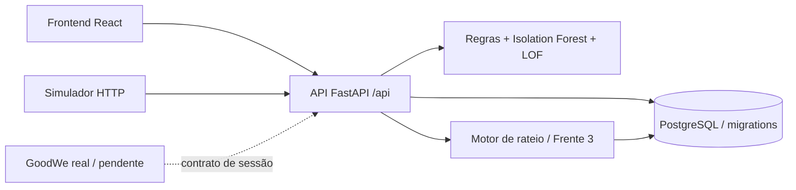

# Integração das Frentes 2, 3, 4 e 5

## Fonte de verdade

Foi escolhido o schema PostgreSQL da Frente 3: 16 tabelas, Decimal/NUMERIC, timestamps com fuso, restrições de capacidade e sobreposição, tarifas versionadas, vínculo reserva/morador, unicidade de sessão faturada e proteção de fatura fechada. Os modelos próprios da Frente 2 não são criados em paralelo.

O backend HTTP adapta os fluxos da Frente 2 a esse schema. O motor de rateio e o serviço de faturamento da Frente 3 são executados diretamente, sem reproduzir a fórmula em outro módulo. A IA da Frente 4 é chamada por um adaptador explícito. O frontend consulta somente a API; credenciais do banco e da IA não chegam ao navegador.

## Mudanças necessárias em relação aos anexos

| Divergência | Decisão na versão integrada |
|---|---|
| Dois bancos distintos, mesmos nomes de tabelas | Schema único da Frente 3; entrega original da Frente 2 preservada em deliveries/frente2 |
| Frontend teria `Gestor`/`Morador`; banco usa `manager`/`resident` | API usa `role` canônico; labels em português serão responsabilidade das telas |
| Código do carregador confundido com PK | Reservas usam charger_id numérico; ingestão usa charger_id como código externo (HCA01), convertido pelo backend |
| Datas sem offset | API exige AwareDatetime; fuso do condomínio America/Sao_Paulo |
| `failed`, `interrupted_by_failure`, `system_failure` | Contrato ativo usa system_failure; adaptador envia interrupted_by_failure à IA |
| `stopped_by_user`, `user_stopped` | Contrato ativo usa user_stopped; adaptador converte para a IA |
| Desconexão anormal tem motivo ambíguo | Persiste como completed mas fica suspensa para revisão; motivo original preservado no evento de auditoria |
| IA ligada por import opcional inexistente | Chamada real da fachada check_session; indisponibilidade do modelo retorna 503 e desfaz a ingestão |
| Modelo binário depende do runtime da pessoa 4 | Modelo ativo reconstruído dos CSVs com as versões fixadas do projeto; anexo binário original preservado sem ser carregado |
| IA conhece apenas HCA01 de 7 kW | Outro código/capacidade fica em revisão por ML_OUT_OF_SCOPE; não é aprovado com falsa evidência de treinamento |
| Tolerâncias diferentes de Green/Grid | Adaptador aplica o limite do rateio (0,05 kWh) antes de aprovar |
| Rateio legado estimava ociosidade usando pico de potência | Motor da Frente 3 usa fim da energia ou curva; sem evidência não inventa ociosidade |
| Falha do sistema ainda podia cobrar energia no backend legado | Regra system_failure_no_charge do motor: valor zero |
| `tariff.snapshot()` sem argumento; `notes.append()` vazio | Corrigidos na cópia ativa; testes originais do motor e faturamento exercitam as correções |
| Ingestão aberta | POST /api/sessoes exige gestor; futura integração física precisará de credencial de serviço própria |
| Reenvio e fontes concorrentes | Mesmo source/session_id e payload retorna duplicate=true; divergência ou recarga sobreposta retorna 409 sem duplicar cobrança |
| No-show cumulativo sem período | Processador usa três faltas nos últimos 30 dias e bloqueio demonstrativo de sete dias |

## Contrato da sessão

Exemplo completo em `docs/session.example.json`. O contrato gerado está em OpenAPI, na definição SessionIn.

- source: simulator, sems ou gateway. Identificador único por source + session_id.
- status: completed, user_stopped, system_failure ou abnormal_disconnection.
- started_at, ended_at e energy_ended_at incluem offset; energy_ended_at é opcional.
- kWh com até três casas decimais; potências com até duas. API recebe strings decimais ou números válidos, mas devolve dinheiro e energia como strings.
- power_samples é opcional; medições devem ser únicas, dentro do intervalo e não negativas.
- atribuição usa reserva do mesmo carregador/conector que contém o instante inicial. O limite final da reserva é exclusivo.
- Cartão RFID compartilhado não atribui automaticamente a cobrança ao custódio. Sessão órfã fica em revisão.
- Quando a estrutura não pode ser persistida (datas inválidas, energia negativa), API retorna 422. Inconsistências físicas persistíveis geram sessão suspensa e anomalia revisável.
- POST de sessão é reservado ao gestor nesta etapa. Morador não altera telemetria.

## Financeiro

A aplicação pode cadastrar novas versões de tarifa e imposto; encerra a versão aberta e cria a seguinte numa transação. O banco impede vigências sobrepostas e alterações dos preços já usados. Não há PUT financeiro genérico.

Faturamento serializado por lock transacional, sem commit por fatura intermediária. Faturas abertas podem ser recalculadas; fechadas são imutáveis. Sessão aprovada tardiamente pode entrar no período seguinte com a tarifa original. Residentes ativos sem consumo recebem fatura zero. Uma sessão não pode aparecer em duas faturas.

`calculation` contém parcelas, critérios, snapshots e observações. Falha do sistema custa zero; parada voluntária não cobra ociosidade. Valores tributários de demo são parâmetros fictícios. O relatório agrega valores faturados; não comprova pagamentos.

## Pendências externas e limites conhecidos

- GoodWe/SEMS: autenticação oficial, endpoints, acesso ao laboratório, campos disponíveis e granularidade de Green/Grid ainda precisam ser comprovados.
- Modbus/gateway: mapa de registradores, buffer SQLite, reconciliação por campo e teste de queda não foram implementados. Hoje a API recusa conflito para análise, em vez de escolher uma fonte sem evidência.
- Sessões atuais/status online do carregador: não há telemetria contínua. API informa telemetry_status=unavailable; evitar indicadores de “online” nas telas.
- Recomendação: baseline de 24 horas com geração solar hipotética, disponibilidade atual e tarifas cadastradas. Não substitui o modelo de regressão/backtest previsto no plano.
- Processamento de no-show: endpoint manual, sem agendador instalado; parâmetro de sete dias é uma decisão demonstrativa a validar com a equipe.
- IA: treinamento do único regime HCA01, sem validação em equipamentos de outra potência. Score não é probabilidade calibrada.
- Arquitetura preparada para desenvolvimento acadêmico. Não houve publicação, implantação externa ou migração de banco pré-existente.
