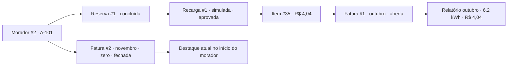

# Diagnóstico de experiência, regras e coerência dos dados

Conferência em **12/10/2026**, entre **12:44 e 12:53**, no fuso de São Paulo. Ambiente local: frontend `127.0.0.1:5173`, API `127.0.0.1:8000/api` e PostgreSQL configurado no projeto. Escopo: diagnóstico; nenhuma correção de aplicação ou de registros foi executada.

## Resultado principal

**A reserva antiga cancelável é um problema confirmado. A cobrança desaparecida não se confirmou no banco atual: ela está na fatura de outubro, mas a página inicial destaca uma fatura futura e zerada.**

- Reserva **#3**, de **09/10, 13:00–18:00**, permanece `active`, aparece como **Agendada** e oferece cancelamento nos dois perfis. A confirmação abre mesmo após o fim da janela.
- Recarga **#1** está corretamente vinculada à reserva **#1**, ao morador **#2**, ao item **#35** e à fatura **#1 de outubro**, aberta, de **R$ 4,04**. Não há sessões aprovadas sem fatura no conjunto atual.
- Fatura **#2 de novembro**, fechada e de **R$ 0,00**, ocupa “Última fatura” no início do morador. O consumo de outubro fica em segundo plano. Ela foi gerada e fechada em **08/10**, antes de novembro começar, como registro de teste anterior.
- Os registros contam uma história de **testes acadêmicos**, não de utilização física nem de pagamentos. Há uma recarga simulada, seis reservas canceladas e uma reserva vencida sem processamento de falta.

O fluxo de cobrança existente é demonstrável. A apresentação ainda precisa explicar dois pontos visíveis: a reserva #3 vencida e a fatura #2 futura. Não é adequado declarar toda a experiência coerente enquanto eles continuarem apresentados sem essa distinção.

## Evidência e método

Foram percorridos os dois perfis no navegador, em **1280 × 900** e **390 × 844**, com login, menus, detalhes, links, filtros, campos e confirmações. Foram salvas **45 capturas**, medidas de largura e foco e árvores de acessibilidade incrementais. As capturas JPEG são a referência visual completa; alguns TXT contêm apenas diferenças de estado.

As consultas HTTP diretas tiveram **39 respostas 200 na coleta inicial** e **38 na final**. Incluem somente GETs e os logins das contas existentes. No navegador, recomendação é consulta GET; “Usar este horário” preenche apenas o formulário. As confirmações de cancelamento, geração e fechamento foram abertas e abandonadas, sem acionar o botão final.

O PostgreSQL foi consultado em transação **REPEATABLE READ, READ ONLY**, com `transaction_read_only=on` e rollback. Foram lidas as **16 tabelas** do modelo canônico. As evidências omitem senha, hash de senha, token e identificação de cartão. O arquivo `.env` não foi copiado.

Houve **33 comparações de registros e campos comuns entre API e banco**, sem divergência. Totais dos relatórios de outubro/novembro coincidem com as faturas. O motor existente recalculou o item #35 **em memória, usando Decimal e os parâmetros cadastrados**, sem diferenças em dinheiro, energia ou ociosidade. Não foi chamado o serviço que gera/persiste faturas.

Os hashes iniciais e finais das **16 tabelas** são iguais, incluindo os **20 eventos de auditoria**. Os **275 arquivos existentes** incluídos na comparação também permaneceram iguais. Somente este relatório e a pasta de evidências foram acrescentados.

## Mapa dos dados e da história

| Entidade | Registro atual | Vínculo e significado |
|---|---|---|
| Morador | #2, Morador Demo | Conta `resident`, ativa e sem bloqueio |
| Unidade | #1, A-101 | Vinculada ao morador #2 |
| Síndico | #1, Síndico Demo | Conta `manager`, ativa |
| Carregador | #1, HCA01 | 7 kW, conector 1, cadastro ativo; telemetria indisponível |
| Reserva utilizada | #1, 08/10, 01:09–04:09 | `completed`, mesmo morador/carregador/conector da sessão |
| Recarga | #1, `source=simulator` | 6,2 kWh; 1 Green + 5,2 Grid; concluída e aprovada |
| Item de cobrança | #35 | Sessão #1, fatura #1, morador #2, tarifa #1 |
| Fatura com consumo | #1, outubro/2026 | Aberta, uma recarga, R$ 4,04 |
| Relatório de outubro | Uma fatura e uma sessão faturada | R$ 4,04; 6,2 kWh registrados e faturados; zero sem faturamento |
| Fatura sem consumo | #2, novembro/2026 | Fechada em 08/10; zero itens/energia/valor |

| Reserva | Janela em São Paulo | Estado | Sessão / cobrança |
|---|---|---|---|
| #1 | 08/10, 01:09–04:09 | Concluída | Sessão #1 → item #35 → fatura #1 |
| #2 | 13/10, 10:00–11:00 | Cancelada | Nenhuma; cancelamento registrado em 08/10 |
| #3 | 09/10, 13:00–18:00 | Ativa / “Agendada” | Nenhuma; janela passada |
| #4 | 13/10, 10:00–11:00 | Cancelada | Nenhuma; nova tentativa na janela de #2 |
| #5 | 09/10, 11:00–12:52:43 | Cancelada | Nenhuma |
| #6 | 14/10, 10:00–11:00 | Cancelada | Nenhuma |
| #7 | 09/10, 11:00–12:52:43 | Cancelada | Nenhuma; janela já liberada por #5 |
| #8 | 12/10, 11:00–12:52:43 | Cancelada | Nenhuma; cancelada em 11/10 |

Reservas canceladas repetindo uma janela não são duplicidade de cobrança: os registros de cancelamento são anteriores às novas tentativas, e não existe sessão associada. **Reservar não produz consumo, fatura ou pagamento por si só.**

### Conferência do valor

| Parcela da fatura #1 | Valor |
|---|---:|
| Green | R$ 0,30 |
| Grid | R$ 3,38 |
| Ociosidade | R$ 0,00 |
| Subtotal | R$ 3,68 |
| Impostos de demonstração | R$ 0,18 |
| Custo operacional | R$ 0,18 |
| Total | **R$ 4,04** |

Não foram encontrados vínculos incorretos, sessões órfãs, reservas concluídas sem sessão, cobrança duplicada, divergência Green + Grid, itens com outro morador, sessões encerradas no futuro ou diferenças entre totais e itens.

## Achados priorizados

### D01 — Reserva passada continua agendada e cancelável

**Prioridade alta · Misto: regra do sistema e estado persistido · Confirmado na interface, API de consulta, banco e código.**

Reprodução: morador → Minhas reservas ou síndico → Agenda → reserva #3. A janela terminou em 09/10 às 18:00; em 12/10 a tela ainda diz “Agendada”. Enter em “Cancelar reserva” abre “Sim, cancelar”. A confirmação final não foi enviada.

**Causa:** `ReservationsPage.tsx:115` decide o botão somente por `status === 'active'`; `backend/api/routes.py:150` também verifica somente o estado. O processamento de faltas existe em `routes.py:162`, mas é manual, sem agendador, e não há botão correspondente no pacote principal. A lista prioriza reservas ativas, promovendo #3 ao topo; os dois dashboards corretamente excluem a mesma reserva das próximas janelas.

**Impacto:** a agenda sugere uma ação futura para algo que já terminou, contradizendo a leitura temporal do início. Corrigir apenas #3 deixaria o problema reaparecer com outras reservas.

**Proposta sistêmica:** retirar o cancelamento de janelas encerradas, explicar o estado temporal sem inventar uma conclusão/falta e aplicar a restrição também na API. A elegibilidade deve ser conferida novamente no envio e após atualização da lista. Uma decisão adicional é necessária: cancelamento será permitido entre início e fim, ou somente antes do início? Também precisa ser escolhida a forma de operação do processamento de faltas; não presumir autorização para um agendador.

**Proposta de dados:** #3 é candidata a `no_show` pela regra atual, sem sessão vinculada. Antes de executar, confirmar que a demonstração deve representar uma falta. Ausência de sessão simulada não prova ausência física. A inspeção da rota atual aponta **somente #3** e **nenhum bloqueio de morador** neste conjunto. O endpoint processa o conjunto inteiro; três faltas nos últimos 30 dias podem gerar bloqueio de sete dias. Reconsultar tudo imediatamente antes de qualquer execução futura. Não cancelar retrospectivamente para disfarçar a falta e não marcar concluída sem recarga.

**Testes para uma correção futura:** reserva ativa futura, instante de início, janela iniciada, instante de fim, reserva passada, demais estados; mesma regra nos dois perfis e na API; confirmação aberta antes de o prazo vencer; contagem de faltas/bloqueio e preservação de canceladas/concluídas.

Evidências: [reserva no desktop](evidence/overview/02-morador-reservas.jpg), [confirmação sem executar](evidence/overview/03-cancelamento-antigo-confirmacao.jpg), [agenda do síndico](evidence/overview/21-sindico-agenda.jpg), [cruzamento](evidence/overview/cross-checks.json).

### D02 — Fatura futura zerada encobre a cobrança atual

**Prioridade alta · Misto: seleção da interface e dado de demonstração · Confirmado.**

Reprodução: início do morador → “Última fatura” → novembro/2026, R$ 0,00, fechada. O link abre #2. Em Minhas faturas, outubro/2026 aparece com R$ 4,04; abrir #1 confirma a recarga #1.

**Causa:** `HomePage.tsx:29` ordena pelo período decrescente e seleciona o primeiro registro, sem comparar com o mês atual. #2 é matematicamente correta como fatura zero, mas foi fechada antes de seu período começar. A geração aceita mês/ano futuro, e `backend/faturamento/service.py:247` fecha a fatura sem exigir fim do período. Trata-se de comportamento permitido pelo contrato atual, não de corrupção dos vínculos ou de dinheiro perdido.

**Impacto:** o usuário vê a recarga recente aprovada ao lado de uma fatura zerada e pode concluir que o consumo não foi cobrado. Além disso, um período fechado antecipadamente deixa de aceitar recalculo; novos consumos elegíveis precisam entrar em outro período, conforme a lógica de lançamento posterior.

**Proposta sistêmica:** destacar a fatura do mês corrente, ou a mais recente até esse mês, e identificar períodos futuros separadamente. Se não houver fatura atual, explicar a ausência; não usar o total de consumo como critério, porque fatura zero pode ser legítima. Definir com a equipe se geração e fechamento antecipados são recursos válidos do MVP ou devem ser restringidos. Essa política não foi inventada nesta revisão.

**Proposta de dados:** preservar #1, seu item e a recarga; **não há motivo para recalcular outubro somente para fazer o valor aparecer**. Preservar #2 como evidência histórica de teste e identificar sua finalidade no roteiro. Não há API de reabertura, exclusão ou mudança de período; removê-la/renomear seu período diretamente exigiria uma operação específica e conflitaria com a proteção de fatura fechada. Uma alteração da seleção do início resolve a visibilidade sem apagar histórico.

**Testes futuros:** #1 atual com consumo + #2 futura zero; mês atual zero; apenas faturas antigas; apenas futuras; sem faturas; preservação de fechadas e lançamentos posteriores sob a política escolhida.

Evidências: [início](evidence/overview/01-morador-inicio.jpg), [lista de faturas](evidence/overview/06-morador-faturas.jpg), [memória de outubro](evidence/overview/07-morador-fatura1-memoria.jpg), [novembro fechado](evidence/overview/32-sindico-fatura2-fechada.jpg), [cronologia e vínculos](evidence/overview/reconciliation.json).

### D03 — Recarga não informa onde foi faturada

**Prioridade média · Sistema / melhoria de experiência · Ausência confirmada, sem defeito de vínculo.**

Reprodução: abrir recarga #1. O morador vê “Aprovada para cobrança”, mas não a reserva vinculada, a fatura ou um atalho para sua cobrança. O síndico vê reserva/morador, porém também não a fatura nessa tela. Na direção inversa, a fatura tem um link funcional para a recarga.

**Causa:** o detalhe usa `SessionOut`, que não traz o destino de faturamento; `SessionOwner` aparece só para o síndico. A interface não cruza os itens das faturas com a sessão. “Aprovada” é validação, não comprovação de faturamento ou pagamento.

**Proposta:** mostrar a reserva e o destino da cobrança com as consultas já disponíveis, incluindo “Incluída na fatura de outubro #1” para este registro. Para uma sessão sem item, descrever apenas o que os dados comprovarem: aguardando revisão, sem morador, ou ainda não incluída. Não atribuir automaticamente uma causa específica à ausência. Não exige nova API para o conjunto atual.

**Dados:** nada a reconciliar na sessão #1; o vínculo já está correto. Testar associação pelo `session_id` inteiro, lançamento posterior em outro mês, fatura indisponível/erro de consulta e sessão não faturada, evitando interpretar estimativas como pagamento.

Evidências: [detalhe do morador](evidence/overview/05-morador-recarga1.jpg), [detalhe do síndico](evidence/overview/23-sindico-sessao1.jpg), [fatura e vínculo](evidence/overview/07-morador-fatura1-memoria.jpg).

### D04 — O banco permite demonstrar consulta e cobrança, mas não toda a operação

**Prioridade média · Estado válido / limitação de dados · Confirmado.**

Há zero anomalias nos três estados e nenhuma reserva ativa futura. A única sessão está aprovada, atribuída e faturada. Filas vazias e “Nenhuma reserva ativa futura agendada” coincidem com a API/banco; não são falhas de carregamento.

**Impacto:** não é possível mostrar agora aprovação/rejeição de uma ocorrência, atribuição órfã ou uma reserva futura já ativa, sem acrescentar registros. A ausência de anomalias não demonstra que as ações de revisão funcionaram nesta conferência.

**Proposta de apresentação/dados:** usar o histórico existente para consulta e cobrança. Em uma etapa futura autorizada, criar apenas uma reserva futura identificada como demonstração, se for necessário mostrar esse estado. Para revisão, declarar o cenário indisponível; não inserir uma anomalia arbitrária, aprovar dados sem fundamento ou alterar a IA para produzir um exemplo. O simulador existente cria e aprova quando necessário; não é adequado executá-lo esperando que deixe uma ocorrência pendente.

Evidências: [dashboard](evidence/overview/20-sindico-inicio.jpg), [fila pendente](evidence/overview/24-sindico-anomalias-pendentes.jpg), [aprovadas](evidence/overview/25-sindico-anomalias-aprovadas.jpg), [rejeitadas](evidence/overview/26-sindico-anomalias-rejeitadas.jpg), `db-before.json`.

### D05 — Calendário de feriados não está preenchido

**Prioridade baixa · Dados/configuração e clareza da interface · Confirmado quanto à configuração; impacto em cobrança atual não demonstrado.**

A tarifa #1 indica “Fins de semana e feriados: Fora de ponta”, mas a tabela `holidays` está vazia. `backend/rateio/bands.py:20` usa os feriados cadastrados; sem eles, somente fins de semana são reconhecidos automaticamente. A tela de parâmetros não informa essa diferença.

**Proposta:** explicitar que a regra depende do calendário cadastrado e confirmar quais datas devem fazer parte da demonstração. Não presumir um calendário real nem modificar valores já faturados. Não há rota de feriados na API atual; preencher esse cadastro requer uma operação específica, fora desta conferência. A recarga atual é de 08/10 fora das janelas especiais e seu valor bate com a configuração existente; não foi encontrada divergência concreta na fatura #1 por esse motivo.

Evidências: [parâmetros](evidence/overview/33-sindico-parametros.jpg), `db-before.json` → `holidays: []`.

## Estados válidos e hipóteses esclarecidas

- **Pagamento:** não existe registro/fluxo de pagamento. As telas consultadas avisam que aprovação e fechamento não comprovam pagamento. Nenhum valor foi classificado como pago. O relato de “paguei” não pode ser confirmado por este banco.
- **Sessão antecipada:** a sessão #1 foi persistida em 08/10 às 00:09, com janela 01:09–04:09, portanto originalmente representou uma simulação acelerada. `scripts/simulate.py` documenta essa prática e a origem é `simulator`. Hoje a sessão não está no futuro. Não tratá-la como telemetria real nem reescrever seus horários para parecer real.
- **Potência média:** 6,2 kWh em três horas equivalem a aproximadamente 2,067 kW sobre todo o intervalo; o registro mostra 2,30 kW. Isso, isoladamente, não comprovou incoerência: `condocharge_ai/ml_model.py` considera um fator de energia/(potência × duração) próximo de 0,90, por pausas de carga. O exemplo tem aproximadamente 0,899. Não alterar energia/potência apenas para forçar igualdade; sem curva, não há comprovação física da definição da média.
- **Estimativa:** 6,2 kWh a 3,3 kW retornaram janela de **13/10, 11:00–12:52:43,636364**, custo sugerido **R$ 2,10**, custo naquele instante **R$ 2,24** e economia **R$ 0,14**. API e tela coincidiram nesta conferência. A estimativa usa Green/Grid hipotéticos e horário diferente da sessão faturada; não precisa igualar os R$ 4,04 de outubro e não representa dinheiro pago. Os valores dependem do instante da consulta.
- **Rascunho:** “Usar este horário” preencheu data/horários e mostrou que nada estava reservado. A janela estava disponível. O envio exato de microssegundos não foi testado nesta revisão, pois o POST criaria registro.
- **Login e atualização:** os perfis receberam seus menus; saída por Enter voltou ao login. Recarregar a página do síndico também exigiu login, conforme o contrato de token em memória. Persistência de autenticação não é um defeito novo demonstrado aqui.

## Propostas de reconciliação, por registro

| Registro | Ação proposta, não executada | Dependência e efeitos |
|---|---|---|
| Reserva #3 | Confirmar a intenção de representar falta e usar o processamento existente, se apropriado | Rota coletiva; revisar candidatas e bloqueios imediatamente antes. Sem endpoint de edição individual para corrigir estado/data. |
| Fatura #1 / item #35 / sessão #1 / reserva #1 | Preservar os vínculos e valores | Tudo conferiu. Recalculo sem necessidade não resolve o destaque da fatura errada e pode trocar IDs internos de itens. |
| Fatura #2 | Preservar, identificar como teste histórico e evitar seu destaque como conta atual | Fechada e imutável; não existe reabertura/exclusão/mudança de período pela API. |
| Reservas #2, #4, #5, #6, #7, #8 | Preservar como histórico de tentativas/cancelamentos | Ausência de cobrança é correta. Não criar sessões retrospectivas para justificar reservas canceladas. |
| Tarifa #1 / calendário vazio | Definir calendário demonstrativo e esclarecer a dependência | Não modificar snapshots de cobranças; cadastro de feriados sem endpoint atual. |
| Fila de anomalias | Preservar e declarar ausência de cenário | Nenhuma revisão persistida comprovada nesta auditoria. |

## Roteiro possível com o banco atual

1. Entrar como **Morador Demo**. Explicar que o aplicativo não registra pagamentos e que o histórico é simulado. Avisar que o destaque de novembro é um teste anterior, até que D02 seja corrigido.
2. Abrir **Minhas reservas**: identificar #1 como a reserva que produziu recarga e as canceladas como testes sem consumo. Mostrar #3 somente explicando a pendência D01; não tratá-la como próxima reserva nem confirmar cancelamento.
3. Em **Minhas recargas**, abrir **#1**: 08/10, HCA01/conector 1, 6,2 kWh, concluída, aprovada, simulação.
4. Em **Minhas faturas**, escolher explicitamente **outubro #1**: R$ 4,04. Expandir por Enter a linha da recarga #1, explicar as parcelas e seguir o link de volta à recarga.
5. Consultar **Sugestão de horário** com 6,2 kWh e 3,3 kW. Explicar a geração solar hipotética. “Usar este horário” pode mostrar o rascunho; não confundir com reserva confirmada.
6. Sair e entrar como **Síndico Demo**. Mostrar oito reservas registradas, uma sessão e zero pendências. Na sessão #1, conferir Morador Demo e reserva #1.
7. No **Financeiro**, escolher **outubro/2026**: uma fatura aberta, 6,2 kWh e R$ 4,04. Abrir o detalhe e mostrar que geração/fechamento exigem confirmação, abandonando-as para manter a base.
8. Consultar **novembro #2** somente como exemplo histórico de fatura zero fechada, gerada antes do período. Não apresentar isso como fechamento financeiro real de novembro.
9. Mostrar **Anomalias** vazias e **Cadastros e parâmetros**: equipamento sem telemetria, tarifa e imposto fictícios. Não prometer revisão persistida, pagamentos ou integração física.

Para um roteiro sem essas ressalvas em tela, D01 e D02 precisam de tratamento posterior. Não foi necessário inventar consumo nem excluir histórico para explicar onde está a cobrança.

## Cobertura e limites

| Área | Resultado atual |
|---|---|
| Login, início e navegação dos dois perfis | Conferidos no navegador; Enter acionou menus, login e saída; foco do conteúdo observado |
| Reservas e agenda | Oito registros conferidos; confirmação de #3 aberta e abandonada |
| Recomendação e formulário | Consulta efetuada; rascunho preenchido; disponibilidade conferida; nenhum POST de reserva |
| Sessões e detalhes | Registro #1 conferido nos dois perfis; vínculos e origem confirmados |
| Faturas e memórias | #1 com consumo e #2 zero; expansão por teclado; links de recarga nos dois perfis funcionaram |
| Financeiro | Outubro e novembro comparados; confirmações abertas/abandonadas; relatório consistente |
| Anomalias | Três filtros vazios, conforme API/banco; não há detalhe/revisão para demonstrar |
| Parâmetros | Carregador, unidade, tarifa/faixas/janelas e imposto conferidos |
| Responsividade | Telas principais e detalhes em 1280/390 px; nenhum `scrollWidth` maior que a largura observado; capturas móveis de reservas, fatura, parâmetros e financeiro também inspecionadas visualmente |
| Console | Zero avisos/erros capturados no console da aba durante o percurso |
| Preservação | 16 tabelas e 275 arquivos anteriores sem diferenças nos snapshots |

Não foram provocadas quedas de serviço, erros de escrita ou disputas simultâneas. Não foram executados build, suíte frontend ou suíte de banco; este diagnóstico não altera código funcional e sua evidência principal é a conferência integrada de leitura. Não houve teste de aparelho físico, instalação PWA, cobrança externa, equipamento real ou aprovação/rejeição persistida. A regra de cancelamento na API foi constatada no código; sua aceitação de um POST passado não foi reproduzida por alterar o histórico.

O campo de mês exigiu eventos reais de teclado para atualizar o estado React durante a automação. A primeira tentativa de preencher alterou somente o valor nativo; nenhuma conclusão foi tirada daquele estado intermediário. Outubro e novembro foram conferidos depois que título, lista e relatório refletiram o mês selecionado.

## Índice das evidências

- [api-before.json](evidence/overview/api-before.json) e [api-after.json](evidence/overview/api-after.json): respostas e log das consultas HTTP diretas, sem credenciais.
- [db-before.json](evidence/overview/db-before.json) e [db-after.json](evidence/overview/db-after.json): todas as tabelas sanitizadas, contagens, modo de leitura e hashes.
- [cross-checks.json](evidence/overview/cross-checks.json): relações, duplicidade, elegibilidade de faltas sem execução, agregações e cálculo puro do item.
- [reconciliation.json](evidence/overview/reconciliation.json): comparação API/banco, cronologia, relatórios e cadeia por reserva.
- [browser-checks.json](evidence/overview/browser-checks.json): horário UTC de cada captura, rota, largura, foco, título e links. JPGs 01–45: telas completas; TXT correspondentes: acessibilidade incremental.
- [reservation-draft.json](evidence/overview/reservation-draft.json): valores visíveis do formulário, sem criação de registro.
- [browser-console.json](evidence/overview/browser-console.json): console da aba.
- [preservation.json](evidence/overview/preservation.json), `files-before.json`, `files-after.json`: comparação dos registros e arquivos anteriores.
- [verification.json](evidence/overview/verification.json): links resolvidos, JSONs válidos, formato das capturas, ausência de credenciais encontradas e resultados finais da conferência.
- [audit_readonly.py](evidence/overview/audit_readonly.py) e [analyze_evidence.py](evidence/overview/analyze_evidence.py): procedimentos usados; executam somente consultas e comparações, escrevendo evidências nesta pasta. A lista HTTP não é uma captura da rede do navegador; a preservação dos registros é comprovada pelos hashes de banco.

**Decisões que permanecem para a etapa de correção:** prazo de cancelamento após o início, operação das faltas, política de fechamento antecipado e calendário demonstrativo. As divergências concretas encontradas estão explicadas; nenhuma alteração foi realizada para ocultá-las.
